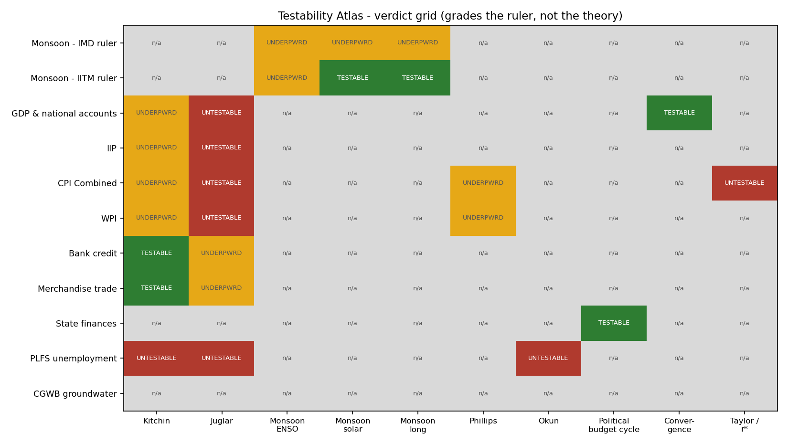
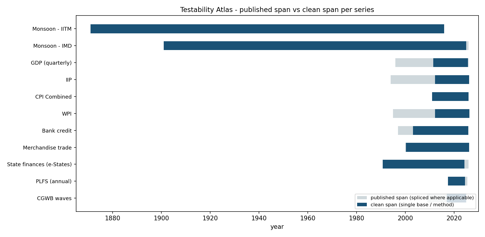

# The Testability Atlas — what Indian official data can and cannot test

**Date:** 2026-11-17 · **Status:** local build, nothing published · **Pre-registration:**
`ATLAS_PREREGISTRATION.md`, committed (git `4167fc2`) before any new data was pulled for
this build; the grid, machinery, anchors, and thresholds below are exactly as registered
there. Re-running `scripts/atlas.py` regenerates every computed number, both CSVs, and
both figures. Pilot numbers reused (monsoon/IIP ρ, the IMD–IITM gap, pilot band
verdicts) are from `REPORT.md`.

**The language rule (registered, and applied to every sentence below):** the Atlas
grades the **ruler, not the theory**. A verdict is a statement about Indian official
data — "on this series' clean span, a test could / could barely / could not detect an
effect of the size the literature treats as meaningful." UNTESTABLE is not evidence
against a theory; TESTABLE is not evidence for it.

## 1. Headline counts

The grid is 10 series × 8 tests = 80 cells. **23 cells are graded** (the monsoon test
is graded once per band, so 21 graded series×test pairs produce 23 graded rows);
**59 cells are NA** — the test does not apply to that series, each with its registered
one-line reason in `data/atlas_grid.csv`.

| Verdict | Cells | Share of graded |
|---|---|---|
| **TESTABLE** | **4** | 17% |
| **UNDERPOWERED** | **11** | 48% |
| **UNTESTABLE** | **8** | 35% |

**Of the 23 questions this grid asks of India's headline statistics, 19 cannot be
answered at literature-sized effects on clean (single-base, single-method) data.**
That is the limitation, computed — the product ASSESSMENT §A proposed.

## 2. The verdict grid

MDES = minimum detectable effect at α = 0.05, power 0.80, under the registered
machinery (spectral: pilot's AR(1)-surrogate band-max test + sinusoid injection;
regression: standard power formulas on the registered inputs). Anchors are the
literature-sized effects fixed in the registration.

| Series | Test | Verdict | MDES | Anchor | Clean n / span |
|---|---|---|---|---|---|
| Monsoon (IMD+IITM) | ENSO 2–7 yr | UNDERPOWERED | IMD 0.69 / IITM 0.68 sd | 0.47 sd (10% var) | 125 / 146 yrs |
| Monsoon (IMD+IITM) | Solar 9.5–12.5 yr | UNDERPOWERED | IMD 0.56 / IITM 0.46 sd | 0.47 sd | 125 / 146 yrs |
| Monsoon (IMD+IITM) | Long 17–21 yr | UNDERPOWERED | IMD 0.55 / IITM 0.43 sd | 0.47 sd | 125 / 146 yrs |
| GDP | Kitchin 3–5 yr | UNDERPOWERED | 1.04 sd (35% var) | 0.59 sd (15% var) | 58 qtrs, 2011-12 base |
| GDP | Juglar 7–11 yr | UNTESTABLE | — (span rule) | 0.59 sd | 58 qtrs = 14.5 yr < 22 yr |
| GDP (GSDP) | Beta convergence | TESTABLE | 1.21 %/yr speed | 1.5 %/yr (Cashin & Sahay) | 28 states, 13-yr difference |
| GDP (GSDP) | Sigma (sub-grade) | UNDERPOWERED | 0.0030 log-pts/yr | drift 0.001–0.003/yr | 13 annual points |
| IIP | Kitchin | UNDERPOWERED | 0.43 sd (capped by span) | 0.59 sd | 167 months growth |
| IIP | Juglar | UNTESTABLE | 0.36 sd (for the record) | 0.59 sd | 13.9 yr < 22 yr (span rule) |
| CPI | Kitchin | UNDERPOWERED | 0.75 sd | 0.59 sd | 180 months, base 2012 |
| CPI | Juglar | UNTESTABLE | — (span rule) | 0.59 sd | 15.0 yr < 22 yr |
| CPI | Phillips slope | UNDERPOWERED | 0.29 pp/pp | 0.25 pp/pp | 58 joint quarters |
| CPI | Taylor / r* | UNTESTABLE | 58 clean qtrs | ≥100 qtrs (structural rule) | joint CPI+GDP+repo |
| WPI | Kitchin | UNDERPOWERED | 0.70 sd | 0.59 sd | 169 months, base 2011-12 |
| WPI | Juglar | UNTESTABLE | — (span rule) | 0.59 sd | 14.1 yr < 22 yr |
| WPI | Phillips slope | UNDERPOWERED | 0.39 pp/pp | 0.25 pp/pp | 58 joint quarters |
| Bank credit | Kitchin | **TESTABLE** | 0.50 sd | 0.59 sd | 272 months, Mar 2003–Oct 2025 |
| Bank credit | Juglar | UNDERPOWERED | 0.47 sd (capped by span) | 0.59 sd | 22.7 yr < 44 yr for full grade |
| Merchandise trade | Kitchin | **TESTABLE** | 0.42 sd | 0.59 sd | 312 months, Apr 2000–Mar 2026 |
| Merchandise trade | Juglar | UNDERPOWERED | 0.37 sd (capped by span) | 0.59 sd | 26.0 yr < 44 yr for full grade |
| State finances | Political budget cycle | **TESTABLE** | 0.20 pp of GSDP | 0.25 pp of GSDP | 952 state-yrs (n_eff 359) |
| PLFS | Kitchin | UNTESTABLE | — (span rule) | 0.59 sd | longest span 6.0 yr < 10 yr |
| PLFS | Juglar | UNTESTABLE | — (span rule) | 0.59 sd | 6.0 yr < 22 yr |
| PLFS | Okun coefficient | UNTESTABLE | 0.16 (formula, for the record) | 0.30 | n = 7 annual (minimum-n rule) |
| CGWB groundwater | all 8 tests | NA | — | — | irregular waves; see §4 |

(Monsoon rows are graded jointly = the worse of the two rulers, as registered; the
heatmap, Figure 1, splits the rulers so their disagreement is visible.)

## 3. The surprising cells

1. **The only TESTABLE business-cycle rulers are the two series nobody rebases.**
   Bank credit (MDES 0.50 sd) and merchandise trade values (0.42 sd) pass the Kitchin
   test because they are *levels* — rupees and dollars, no base year, no basket —
   with 23 and 26 clean years. Every rebased index fails or is capped: GDP, IIP,
   CPI, WPI. In this grid, testability tracks **ruler stability, not importance**.
2. **GDP is the worst cycle ruler in the grid.** A Kitchin cycle in quarterly GDP
   growth would have to explain ~35% of the series' variance (MDES 1.04 sd) to be
   detectable at 80% power on the 58 clean quarters of the 2011-12 base — and the
   Juglar cell is span-rule UNTESTABLE outright. The flagship series can say the
   least about the flagship cycle theory.
3. **The political budget cycle inverts the pilot's H3 verdict.** Spectrally, at
   annual frequency, state finances were UNTESTABLE (pilot §4) — and remain so. As
   Khemani's regression design on the same underlying budgets, the cell is
   **TESTABLE**: MDES 0.20 pp of GSDP on capital outlay against a 0.25 pp anchor,
   and 0.29 pp against the 0.50 pp deficit anchor — so even Khemani's famous
   *null* ("election years do not move deficits") is a gradeable statement on the
   modern 28-state panel. Same data, different design, opposite verdict: the
   limitation lives in the pairing of question and ruler, not in the archive.
4. **Okun's law is UNTESTABLE — and its formula number is a trap.** The naive
   power formula on PLFS's 7 annual points returns MDES 0.16, apparently fine
   against the 0.30 anchor. It is mechanically flattered by a single leverage
   point: the COVID year inflates sd(growth) while unemployment barely moved
   (in a ~90%-informal economy the shock surfaced as earnings, not open
   unemployment). The registered minimum-n rule (n < 20 → UNTESTABLE) exists
   precisely for this cell. India's most-argued labour-market question currently
   has no ruler that can grade it — the pre-2017 EUS is officially "not
   comparable", and the PLFS ruler restarted in 2017 and was redesigned in 2025.
5. **The natural rate is published routinely and is UNTESTABLE on clean data.**
   RBI's r* estimates (1.4–1.9%) rest on spliced series plus model structure.
   Under the no-splice rule, the joint CPI+GDP clean span is 58 quarters against
   a 100-quarter floor for Laubach–Williams-class estimation. The number exists;
   a data-only test of it does not.
6. **The two monsoon rulers disagree about testability itself.** On the longer
   IITM ruler, the solar and long bands are TESTABLE (MDES 0.46 / 0.43 sd vs the
   0.47 anchor); on the IMD ruler they are UNDERPOWERED (0.56 / 0.55). And both
   rulers are powered only for strong cycles: in the ENSO band the detectable
   floor is ~19% of variance. This *qualifies* the pilot's headline: its null
   rules out Kane-strength dominant peaks, but a cycle explaining a tenth of
   monsoon variance — the registered literature anchor — would escape the
   pilot's test about half the time. (Kane's own MESA method has sharper peak
   resolution; the Atlas grades the registered periodogram test, not his.)
7. **Convergence is testable in regression form and not in dispersion form, on
   the same data.** Beta: the 28-state cross-section over one clean decade can
   just detect a Cashin–Sahay-speed convergence (MDES 1.21%/yr vs 1.5%/yr
   anchor). Sigma: the detectable dispersion drift (0.0030/yr) sits at the very
   top of the literature's range — a decade of clean GSDP cannot grade whether
   states are actually spreading apart or closing.

## 4. Per-series audit summaries

Full machine-readable audit: `data/series_audit.csv` (11 rows — the monsoon gets
one per ruler). Revision *magnitudes* are marked **pending D** (the vintages
build, ASSESSMENT §D) wherever no documented source states them; nothing was
estimated in their place (registered rule R4).

- **Monsoon — IMD (1901–2025, n=125) / IITM (1871–2016, n=146).** The only
  series pair with a *measured* cross-ruler gap: over identical years 1901–2016,
  IMD's JJAS mean is 887.3 mm vs IITM's 843.6 mm (+5.2%), r = 0.947 (pilot). No
  base breaks on either ruler; they differ by construction (operational
  subdivisional weighting vs a 306-station homogeneous network). ρ real: +0.03
  (IMD), −0.10 (IITM) — the sign of the monsoon's memory depends on the ruler.
- **GDP & national accounts.** Published quarterly span runs from 1996-97, but
  spliced across three bases (2004-05 → 2011-12 → 2022-23, Feb 2026); the clean
  quarterly span is 58 quarters on the 2011-12 base, and the new base currently
  covers only 2022-23–2025-26 with its back series pending (expected Dec 2026).
  Documented two-ruler gap on identical years: FY2023-24 growth **9.2%**
  (2011-12 base) vs **7.2%** (2022-23 base); FY2024-25 6.5% vs 7.1%. Revision
  ladder documented (advance → provisional → revised → final over ~3 years);
  IMF Article IV data-adequacy grade "C" (2024/2025). Magnitudes pending D.
- **IIP.** Clean span Apr 2012–Mar 2026 on base 2011-12 (pilot pull, n=168);
  ended by the 2022-23 rebasing (Jun 2026). Quick estimates are revised over
  the following two releases (documented); magnitudes pending D. The pilot's
  Juglar "not supported" (p = 0.94) is sharpened by the Atlas: on 13.9 clean
  years the Juglar test is UNTESTABLE by the span rule — the pilot window
  could not have supported the band whatever it contained.
- **CPI Combined.** Exists only from Jan 2011; clean span Jan 2011–Dec 2025 on
  base 2012 (n=180). The base-2024 series (Feb 2026; food weight 45.86% →
  36.75%) has index values from Jan 2025 but YoY inflation comparable only from
  Jan 2026 — the inflation-targeting era's ruler has already been replaced
  before accumulating a gradeable span of its own. Documented revision:
  provisional → final next month (Jan 2026: 2.75% → 2.74%). Official linking
  factor to the new base: 0.5267.
- **WPI.** Clean span Apr 2012–Apr 2026 on base 2011-12 (n=169), ended by the
  2022-23 rebasing (Jun 2026). The ruler on which the classic Indian Phillips
  estimates were run (RBI 2002; Kapur & Patra 2003, spliced) now offers only
  58 clean joint quarters, and its higher residual variance makes its Phillips
  MDES (0.39) worse than CPI's (0.29).
- **Bank credit (SCB non-food).** The grid's quiet winner: monthly levels with
  a definition stable since Nov 1960 (RBI Handbook notes), no base years.
  Clean span Mar 2003–Oct 2025 (n=272). Breaks are coverage events, not
  rebasing: the Jul 2023 HDFC merger level shift, the Jan 2021 sectoral format
  revision, documented adjustments for reporting errors. Assumed ρ = 0.30
  (registered) — see honest gaps.
- **Merchandise trade (exports, values).** Levels again: no base year attaches
  to values (only the DGCIS unit-value/quantity *indices* were rebased, Feb
  2026). Clean span graded conservatively as Apr 2000–Mar 2026 (n=312).
  Documented revision behaviour: quick estimates revised subsequently; RBI
  table note that monthly figures may not add to annual on account of
  revision. Assumed ρ = 0.15 (registered).
- **State finances.** Annual, but a *panel*: RBI's e-States time series from
  1990-91 gives 28 states × 34 years = 952 state-years on budget documents
  (no base years; coverage notes: UTs with legislature enter from 2017-18;
  bifurcations 2000/2014/2019 handled in RBI's consistent presentation). The
  second ruler exists — CAG audited accounts — and RBI itself notes the two
  "could differ"; the gap is documented-only, not measured here.
- **PLFS unemployment.** The youngest ruler: launched Apr 2017, officially not
  comparable with the NSS EUS it replaced; annual usual-status clean span is
  7 points (2017-18–2023-24), ended by the Jan 2025 design revamp and the
  shift to calendar-year reporting. Quarterly urban CWS (2019–2024, n=24) is
  noted but not graded (registered rule R5: urban-only CWS vs national
  output). Monthly CWS exists from Apr 2025 — a future ruler, not yet a span.
- **CGWB groundwater.** NA on all eight tests, by design: assessment waves
  (2009, 2013, 2017, 2020, 2022–2025) are irregular cross-sections, not a
  fixed-frequency series, and the GEC-97 → GEC-2015 method break at 2017
  leaves 6 like-for-like waves. Its audit row exists because this series
  powers the future Shah build (ASSESSMENT §B) — an honest grid shows the
  load-bearing series none of the registered theories can use.

## 5. Honest gaps and deviations

1. **Registration erratum (counting, not design).** `ATLAS_PREREGISTRATION.md`
   §1 says "57 NA"; the correct count is **59 NA** of 80 series×test pairs
   (21 graded pairs, of which the monsoon pair expands to 3 band rows = 23
   graded rows). The grid implemented is exactly the registered grid; only the
   registration's arithmetic summary was wrong. Recorded here rather than by
   editing the registration.
2. **Assumed inputs.** ρ for GDP (0.35), CPI (0.50), WPI (0.45), credit (0.30),
   trade (0.15) and all regression σ/sd inputs are registered *assumptions*
   anchored to published magnitudes, not measurements — this build pulled no
   new series data beyond the pilot's. Three verdicts sit within ~25% of a
   boundary and could move if measured inputs replaced assumed ones:
   Phillips–CPI (MDES 0.29 vs the 0.25 TESTABLE boundary), convergence beta
   (1.21 vs 1.5 %/yr, with the 2× boundary at 0.75 %/yr-equivalent slope —
   comfortably UNDERPOWERED-proof but boundary-adjacent on the TESTABLE side),
   and PBC capital outlay (0.20 vs 0.25). A follow-up that pulls the real
   series from DBIE/eSankhyiki and re-runs `scripts/atlas.py` with measured
   ρ/σ is the obvious next increment; no verdict in §2 should be quoted
   without this caveat for those three cells.
3. **Cross-ruler gaps are measured for one pair only** (monsoon, from pilot
   data) and documented for one more (GDP, from published releases). The IIP
   old/new-base overlap (from 2022-23) and the CPI overlap-year inflation gap
   exist but were not extracted — pending D-grade work, recorded as such in
   the audit rather than estimated.
4. **Revision behaviour is documented-only throughout** (rule R4): ladders,
   calendars, and single documented events (e.g. CPI Jan 2026, −0.01 pp) are
   recorded; every systematic revision *magnitude* is pending D.
5. **The spectral MDES grades the registered test** (periodogram + band-max +
   AR(1) null), not every possible test: a sharper method (Kane's MESA) would
   have a lower MDES on the same spans. The Atlas's claim is about the data
   under a uniform, conservative, pre-registered ruler — which is the
   comparison the pilot established.
6. **Implementation detail (not a deviation):** injected sinusoids use random
   phase (uniform, seed 43) — the registration fixed the amplitude grid,
   centre frequency, and trial count but not the phase; random phase is the
   conservative choice. The vectorised periodogram in `scripts/atlas.py` was
   checked against scipy's on the pilot's IMD series (band maxima agree to
   <1%); identical machinery is applied to nulls, trials, and thresholds, so
   MDES values are internally consistent.

## 6. Files

- `ATLAS_PREREGISTRATION.md` — registered before the build (git `4167fc2`)
- `data/series_audit.csv` — 11 ruler rows, §5 schema of the registration
- `data/atlas_grid.csv` — all 82 rows (80 pairs; monsoon × 3 bands), verdicts,
  MDES, anchors, reasons
- `data/atlas_summary.json` — computed values behind every number above
- `scripts/atlas.py` — re-runnable end to end (~10 s)
- `figures/fig_atlas_heatmap.png`, `figures/fig_atlas_spans.png`

*Language discipline, per registration: every verdict above grades a ruler.
Nothing here is evidence for or against any theory named.*
